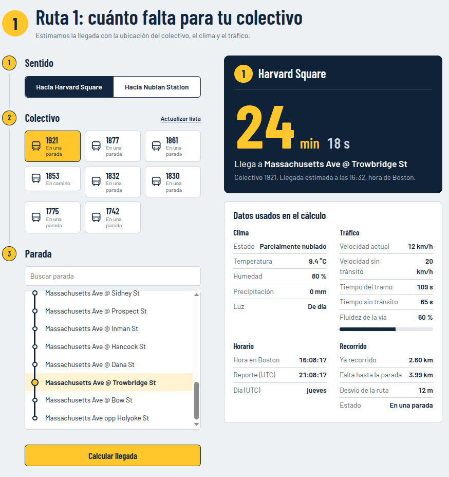

<p align="center">
  
</p>

# ⏱️ Estimación de ETA - Ruta de Bus Harvard Square - Nubian Station

**Asignatura:** Inteligencia Artificial - Ingeniería en Informática (CRUC - IUA - UNDEF)  
**Docente:** Ing. Hernando Alexis González
**Ciclo Lectivo:** 2026  


## 📋 1. Información General y Modalidad

* **Integrantes:** 
  * Celeste Antonella Badami (`cbadami845@alumnos.iua.edu.ar`)
  * Benjamin Vargas (`bvargas161@alumnos.iua.edu.ar`)
* **Modalidad Elegida:** Grupal (MVP Funcional)
* **Categoría Tecnológica:** Machine Learning Predictivo & Data Engineering


## 🎯 2. Propuesta Formal (Project Charter)

### 2.1. Definición del Problema
* **Descripción funcional:** El transporte público urbano sufre variaciones constantes en los tiempos de viaje debido a factores operativos, congestión vehicular y condiciones climáticas. El objetivo de este proyecto es desarrollar un modelo de Machine Learning capaz de estimar de forma precisa el tiempo estimado de arribo (**ETA**, expresado en segundos) de los autobuses de la ruta *Harvard Square - Nubian Station* hacia sus próximas paradas en la traza, utilizando datos telemétricos en tiempo real e información meteorológica y de tráfico.
* **Modelado del Entorno (PEAS):**
  * **Performance (Medida de rendimiento):** Minimización del error de predicción de tiempo (MAE y RMSE en segundos) y baja latencia de inferencia.
  * **Environment (Entorno):** Red vial urbana de la ruta *Harvard Square - Nubian Station* (dinámico, estocástico, parcialmente observable).
  * **Actuators (Actuadores):** Predicción numérica del tiempo de arribo (`eta_segundos`) expuesta mediante script de inferencia / JSON.
  * **Sensors (Sensores):** Feeds telemétricos GTFS-Realtime (posición GPS, estado del vehículo, ocupación), API de tráfico TomTom (`confidence`, `road_closure`) y API meteorológica (temperatura, precipitación, humedad).

### 2.2. Origen y Naturaleza de los Datos
* **Fuente del Dataset:** Recolección automatizada mediante un bot cosechador que integra datos telemétricos de unidades en circulación (MBTA API), condiciones de tráfico (TomTom API), variables climáticas (OpenMeteo API), y la geometría oficial de paradas de la ruta.
* **Volumen y Estructura:** Dataset tabular (`dataset.csv`) compuesto por registros cronológicos por unidad (`bus_id`) y sentido (`direction_id`: `0` Outbound hacia Harvard, `1` Inbound hacia Nubian Station). Incluye variables espacio-temporales (`date_time`, `latitude`, `longitude`, `distancia_en_traza`), operativas (`current_status`, `occupancy_status`, `current_speed`), de tráfico (`confidence`, `road_closure`) y meteorológicas (`temperature_2m`, `precipitation`, `relative_humidity_2m`, `weather_code`, `is_day`). La variable objetivo construida es `eta_segundos`. Se recolectaron aproximadamente 11500 muestras.
* **Consideraciones de Calidad, Limpieza y Prevención de *Data Leakage*:**
  * **Valores Faltantes:** Las variables críticas de geolocalización, temporalidad y tránsito están completas. Los nulos en variables climáticas se imputan mediante propagación temporal bidireccional (`bfill` seguido de `ffill`). Los registros sin reporte de ocupación (`1.28%` del total) se imputan con la clase mayoritaria (`MANY_SEATS_AVAILABLE = 1`).
  * **Detección y Filtrado de Outliers:** El bot cosechador incluye la bandera `es_desvio` (distancia > 70 metros respecto a la traza oficial). Dado que los desvíos distorsionan la estimación lineal sobre la ruta, se descartan íntegramente todos los viajes (`trip_id`) que hayan registrado al menos un desvío. Asimismo, se corrigen lecturas anómalas de velocidad (`> 90 km/h` o detenciones con delta nulo/negativo).
  * **Prevención de *Data Leakage*:** Se eliminan todas las paradas ya superadas por el vehículo (`distancia_restante_km <= 0.03 km`) y aquellas paradas que quedaron truncadas al finalizar la captura del viaje (sin timestamp real de llegada). Además, se purgan identificadores internos (`trip_id`, `bus_id`), coordenadas crudas y timestamps absolutos antes del entrenamiento.

### 2.3. Métricas de Éxito y Baseline
* **Baseline (Punto de comparación sin IA):** Cálculo cinemático simple basado en la distancia restante sobre la traza dividida por la velocidad instantánea actual (`distancia_restante_km / current_speed`), o el tiempo programado teórico del cronograma GTFS sin ajuste dinámico.
* **Métricas Objetivo del Modelo:**
  * Superar el error del baseline logrando un **MAE (Error Absoluto Medio) < 55 segundos** y un **RMSE < 85 segundos**.
  * Coeficiente de determinación **$R^2 >$ 0.85**.

### 2.4. Límites del Alcance (Out of Scope)
* **Exclusiones explícitas del MVP:**
  * Predicción de ETAs en escenarios de desvíos imprevistos o cortes de ruta activos (excluidos deliberadamente del dominio de entrenamiento), asi como la predicción fuera de la ruta establecida (No se cuentan consuficientes datos).


## 🏗️ 3. Arquitectura del Proyecto y Estructura del Repositorio

El proyecto está distribuido de la siguiente forma:

```text
├── data/                   # Datasets crudos y procesados (Excluido en .gitignore)
|   └── dataharvesterbot/   # Bot recolector de datos telemétricos, tráfico y clima
├── images/                 # Recursos gráficos y capturas del análisis exploratorio
├── models/                 # Artefactos de modelos entrenados serializados
├── notebooks/              # Cuadernos Jupyter de exploración (EDA), prototipado y pipelines
├── src/                    # Código fuente modularizado
│   ├── back/               # Lógica de procesamiento, modelo e inferencia / API
│   └── front/              # Interfaz de usuario
├── .gitignore              # Exclusión de /data, entornos virtuales y temporales
├── requirements.txt        # Dependencias con versiones fijadas (version pinning)
└── README.md               # Documentación principal del proyecto
```

## ⚙️ 4. Pipeline de Datos e Ingeniería de Características

El flujo de transformación implementado convierte los logs crudos en un dataset supervisado listo para entrenamiento:

1. **Segmentación de Viajes (`trip_id`):** Ordenamiento por unidad y sentido, generando cortes de viaje ante pausas mayores a 15 minutos o retrocesos en la traza mayores a 1 km.
2. **Ingeniería Temporal Cíclica:** Conversión a UTC y transformación de la hora del día mediante funciones trigonométricas (`hora_sin`, `hora_cos`) para conservar la continuidad entre las 23:59 y las 00:00, junto con `dia_semana` y `es_fin_de_semana`.
3. **Cálculo de Velocidad Real (`velocidad_traza_kmh`):** Estimación basada en deltas de distancia y tiempo entre pings consecutivos, filtrando frenados y saltos de GPS (`> 90 km/h`, imputados con `current_speed`).
4. **Cruce Espacial y Construcción del Target (`eta_segundos`):** Cruce por `shape_id` con el catálogo de paradas para calcular `distancia_restante_km`. El tiempo real de llegada (`tiempo_llegada`) se infiere a partir del primer reporte posterior a la desaparición de cada parada en el feed activo del viaje.
5. **Codificación de Variables Categóricas:** Mapeo binario de `current_status` (`STOPPED_AT: 0`, `IN_TRANSIT_TO: 1`) y ordinal de `occupancy_status` (`1` a `3`).

Para más detalles consultar el archivo "notebooks/02_eda_pipeline_M1"


## 💻 5. Entorno de Desarrollo y Reproducibilidad

### 5.1. Requisitos Previos

* Python `>= 3.10`
* Gestor de entornos virtuales `venv`

### 5.2. Instalación y Configuración

1. **Clonar el repositorio:**
```bash
git clone https://github.com/AntoBadami/routing-engine.git
cd routing-engine

```

2. **Crear y activar el entorno virtual (aislamiento obligatorio):**
```bash
python -m venv venv

source venv/bin/activate

```

3. **Instalar dependencias para implementar /notebooks:**
```bash
pip install -r requirements.txt
```
## 🚀 6. Ejecución y Uso del Sistema (MVP)

1. **Ejecutar el backend**
con el entorno virtual creado previamente y activado:
```bash
 cd src/back
 pip install -r requirements.txt
 uvicorn app.main:app
```

*(Requiere ubicar `paradas_distancia_traza.csv` dentro de la carpeta `/data`, asi como el archivo GTFS.zip descargado desde https://www.mbta.com/developers/gtfs).*

Es necesario crear un archivo .env (basarse en .env.example) dentro del back donde se colocaran las API key de Tomtom y MBTA.
Dichas keys se pueden gestionar en https://my.tomtom.com/ y https://api-v3.mbta.com/portal respectivamente

2. **Ejecutar frontend:**
```bash
    cd src/frontend # pararse en el directorio del frontend
    npm install     # Instalación de dependencias
    npm run dev     # Iniciar app web
```


## 📊 7. Resultados y Validación Estadística


| Modelo / Enfoque | MAE (segundos) | RMSE (segundos) | $R^2$ |
| :--- | :---: | :---: | :---: |
| **LightGBM Regressor (Final)** | **153.11 s (2.55 min)** | **224.97 s (3.75 min)** | **0.9045** |


- **Análisis de Errores:**
  - **Desempeño Global:** El modelo logra explicar más del 90% de la variabilidad del tiempo de arribo ($R^2 = 0.9045$) con un error porcentual medio (MAPE) del **19.79%** y una relación $\text{RMSE}/\text{MAE} \approx 1.47$, lo que indica una baja presencia de errores atípicos extremos.
  - **Comportamiento por Tramo de Distancia:** El error absoluto aumenta de forma proporcional a la distancia restante debido a la acumulación de incertidumbre vial (semáforos y congestión), pasando de **85.42 s** en tramos cercanos (`< 1 km`) a **135.84 s** en tramos medios (`1 - 3 km`) y **213.39 s** en distancias largas (`> 3 km`). Por el contrario, el error relativo (MAPE) mejora a medida que el trayecto es más largo (bajando del **30.05%** en `< 1 km` al **14.27%** en `> 3 km`), ya que en distancias muy cortas las demoras puntuales en parada tienen un peso porcentual alto sobre un ETA total pequeño.
  - **Variables Determinantes:** Las variables con mayor peso en las decisiones del modelo son las componentes cíclicas horarias (`hora_sin`, `hora_cos`), la ubicación y distancia pendiente en la traza (`distancia_en_traza`, `distancia_restante_km`, `progreso_recorrido`) y las condiciones ambientales (`temperature_2m`, `relative_humidity_2m`), confirmando que la hora pico y la posición exacta en el recorrido son los principales factores de dispersión del tiempo de viaje.

## 🖼️ 8. Capturas de la Interfaz

### Pantalla Principal (Dashboard)
Vista general de las métricas y accesos rápidos.

